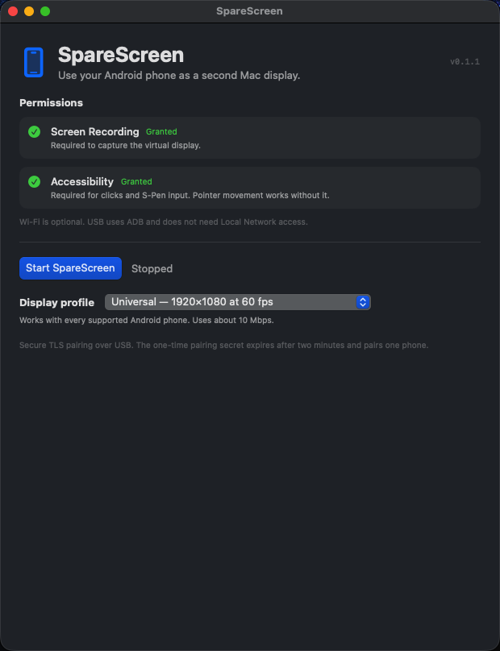
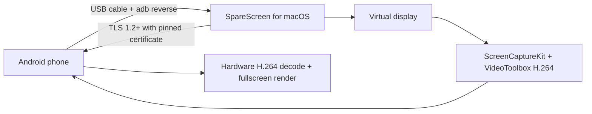

<p align="center">
  
</p>

<h1 align="center">SpareScreen</h1>

<h3 align="center">Your spare Android phone, as a second Mac display.</h3>

<p align="center">
  <a href="https://github.com/pratham-rog/sparescreen/releases/latest"></a>
  <a href="https://github.com/pratham-rog/sparescreen/releases/latest"></a>
</p>

<p align="center">
  <a href="https://github.com/pratham-rog/sparescreen/releases/latest"></a>
  <a href="https://github.com/pratham-rog/sparescreen/actions/workflows/ci.yml"></a>
  <a href="LICENSE"></a>
  <a href="https://github.com/pratham-rog/sparescreen/stargazers"></a>
</p>

<p align="center">
  USB · TLS-pinned · 1080p60 / 1440p90 · S-Pen input · macOS 14+ · Android 8+
</p>

SpareScreen turns a spare Android phone into a low-latency second display for a
Mac. It is free, open source, local-only, and has no accounts, cloud, ads, or
telemetry. USB is the supported transport; Wi-Fi is not part of this release.

> **Name note:** SpareScreen was previously called PhoneDisplay. The internal
> bundle and application IDs remain `dev.phonedisplay.app` so existing installs,
> pairing secrets, and macOS permissions survive the rename.

<p align="center">
  
</p>

| 🚀 [Download](#download) | ⚡ [Quick start](#quick-start) | 🧠 [How it works](#how-it-works) | 🛠 [Build](#build-from-source) | 🔐 [Security](#security) | 🧰 [Troubleshooting](docs/troubleshooting.md) |
| --- | --- | --- | --- | --- | --- |

## Download

Pick the files for your devices from the
[latest release](https://github.com/pratham-rog/sparescreen/releases/latest):

| File | Use it when |
| --- | --- |
| **`SpareScreen-0.1.1-macOS.dmg`** | **Not sure? Take this one.** Open the DMG and drag SpareScreen to Applications. |
| **`SpareScreen-0.1.1-android.apk`** | Install on the Android phone. Android 8.0 or newer. |
| `SHA256SUMS` | Verify both downloads before installing. |

```sh
shasum -a 256 -c SHA256SUMS
```

The macOS app is ad-hoc signed, not notarized. The first time, open it with
**System Settings → Privacy & Security → Open Anyway**. The Android APK is
release-signed, but it is not from the Play Store.

> If you previously installed a debug-signed Android build, uninstall it first.
> Android will not update across a signing-key change. Release builds from
> v0.1.0 onward can update in place.

## Quick start

1. Install the macOS app and the Android APK.
2. On the phone, enable **Developer options → USB debugging** and authorize the
   Mac when prompted.
3. Connect the phone with a USB data cable.
4. Open SpareScreen on the Mac and grant **Screen Recording** and
   **Accessibility** when asked.
5. Choose a display profile, press **Start SpareScreen**, and wait for the phone
   to open and pair automatically.

The Mac finds the authorized ADB device, sets up `adb reverse`, and sends a
one-time pairing intent over USB. The phone pins the Mac certificate, receives a
per-phone secret, and starts streaming. Later launches reconnect automatically;
press **Connect** on the phone if the stream was stopped.

## Why SpareScreen

| | |
| --- | --- |
| **Reuse what you have** | A spare Android phone becomes a real second display instead of another purchase. |
| **USB, not Wi-Fi** | No same-network requirement, no discovery, no router configuration. |
| **Low latency** | Hardware H.264 encode/decode with a 1920×1080@60 default and a 3120×1440@90 profile. |
| **Private by design** | TLS with a pinned self-signed identity, one-time USB pairing, no cloud, no telemetry. |
| **Made for the desk** | S-Pen and cursor input, one active phone, idle teardown, and pause on Mac sleep/lock. |
| **Free and open** | MIT licensed. No Apple Developer Program, notarization, App Store, or Play Store. |

## Requirements

- **Mac:** macOS 14 or newer. Apple Silicon is the primary target; Intel is best
  effort.
- **Phone:** Android 8.0 (API 24) or newer, with USB debugging enabled.
- **Cable:** a USB data cable. Charge-only cables will not work.
- **Mac tooling:** `adb` from Android platform-tools, Android Studio, or
  Homebrew.
- No same-Wi-Fi network and no QR scanner are needed.

## Display profiles

- **Universal — 1920×1080 at 60 fps** (default, roughly 10 Mbps).
- **Galaxy S24 — 3120×1440 at 90 fps** (roughly 20 Mbps).

Choose the profile on the Mac before starting. The phone follows the Mac’s
stream rate on first run; the in-app **60/90** pill overrides it and is
remembered. While streaming, tap the top-left corner or use the pen to reveal
the pill.

The stream fills the phone screen. At the 60 profile the 16:9 image is scaled to
3120×1440 and the top and bottom are center-cropped; at the 90 profile it fills
exactly. The menu bar and Dock can be cut at the 60 profile.

## How it works



- **Mac:** native SwiftUI app around a small Objective-C/ScreenCaptureKit helper
  (`vdhelper`). Creates a virtual display and hardware-encodes H.264.
- **Android:** native Kotlin app. Pairs over USB, pins the Mac’s TLS certificate,
  hardware-decodes H.264, and renders fullscreen.
- **Transport:** TLS 1.2+ over the USB loopback link, with a one-time
  ADB-delivered pairing token and a separate per-phone device secret.

## Security

- Self-signed P-256 TLS identity generated on the Mac and stored with `0600`
  permissions.
- The one-time pairing payload travels over the authorized USB/ADB link and
  carries the certificate SHA-256 fingerprint. Android refuses any other
  certificate.
- Pairing token: 32 random bytes, one use, two-minute expiry.
- Device secret: 32 random bytes, per phone, revocable by re-pairing.
- One active phone at a time; heartbeat every 5 seconds; silent clients are
  dropped after 15 seconds.
- The virtual display and helper stop after 10 seconds without an active phone.
- Mac sleep, display sleep, and screen lock pause the stream and release the
  virtual display; the phone reconnects after wake/unlock.
- On a static Mac screen, a reconnecting phone receives the last encoded
  keyframe so it does not stay black waiting for a screen change.
- Never share `host-macos/stream.log`: it may contain a legacy token. The secure
  app does not print the pairing token or device secret.

See [SECURITY.md](SECURITY.md) for the private vulnerability reporting process.

## Build from source

### macOS app

```sh
cd mac/PhoneDisplay
./build.sh
open SpareScreen.app
```

The app is ad-hoc signed and not notarized. A downloaded build needs
**Open Anyway** on first launch. On first run grant:

1. **Screen Recording** — required to capture the virtual display.
2. **Accessibility** — required for clicks and S-Pen input; pointer movement
   works without it.
3. **Local Network** — only if macOS asks when the listener starts; USB does not
   use it.

### Android app

```sh
cd android
./gradlew :app:assembleRelease
# APK: app/build/outputs/apk/release/app-release.apk
```

Release builds require the git-ignored `android/keystore.properties` and its
keystore. The APK is signed with the local release key, not a Play Store key.

When the phone is reachable over USB:

```sh
adb install -r android/app/build/outputs/apk/release/app-release.apk
```

### Tests

```sh
cd mac/PhoneDisplay
swift run -c release PhoneDisplayCoreChecks

cd android
./gradlew test
```

The TLS path can be exercised without a phone using
`tools/testclient_tls.py`; see the [Mac development notes](mac/PhoneDisplay/README.md).

### Release packaging

```sh
VERSION=0.1.1 ./tools/package_release.sh
```

Produces:

```text
dist/SpareScreen-0.1.1-macOS.dmg
dist/SpareScreen-0.1.1-android.apk
dist/SHA256SUMS
```

`android/keystore.properties` is required for release builds and is never
committed. Back up both that file and the referenced keystore: losing the key
means existing installs cannot receive updates without uninstalling and
re-pairing.

## Project layout

```text
mac/PhoneDisplay/   SwiftUI app, TLS host, pairing, helper lifecycle
android/            Kotlin Android client
host-macos/         vdhelper + legacy Python host harness
tools/              TLS test client, release packaging
docs/               architecture, troubleshooting, technical report, logo assets
.github/            CI, issue templates, and pull-request template
```

## Current limits

- Tested on a Galaxy S24 Ultra (SM-S928B): USB pairing, TLS, 1080p60, 1440p90,
  reverse recovery, idle teardown, relaunch/reconnect, and permissions.
- Physical S-Pen hover, tap, right-click, and 3× cursor still need a hands-on
  check. Synthetic stylus injection enters pen mode.
- Wi-Fi is deferred; USB is the only supported transport in this release.
- The macOS 14 TLS identity ACL fallback compiles but was not tested on macOS 14.
- No Bonjour discovery; USB pairing is automatic after the first connection.
- No Windows host yet.
- The macOS 27 fullscreen-Space bug is an OS bug; move a normal window to the
  phone display and fullscreen it there.

See [docs/troubleshooting.md](docs/troubleshooting.md) for fixes,
[docs/architecture.md](docs/architecture.md) for the component and protocol
overview, and [docs/technical-report.md](docs/technical-report.md) for the full
technology and build report.

## Contributing

Issues and pull requests are welcome. Please read
[CONTRIBUTING.md](CONTRIBUTING.md) and
[CODE_OF_CONDUCT.md](CODE_OF_CONDUCT.md) first. Security reports should follow
[SECURITY.md](SECURITY.md), not a public issue.

## License

MIT — see [LICENSE](LICENSE).
