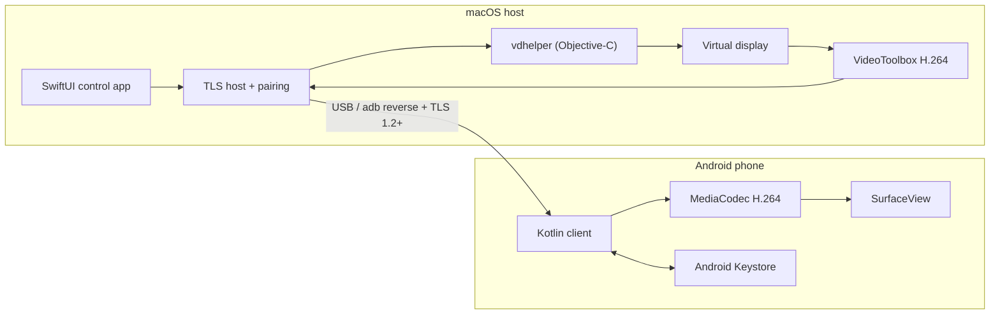

# SpareScreen — Technical Report

**Version:** 0.1.1  
**Date:** 11 November 2026  
**License:** MIT  
**Repository:** https://github.com/pratham-rog/sparescreen

## 1. Summary

SpareScreen turns an Android phone into a low-latency second display for a
Mac. It is a native macOS + Android application, not an Electron or React
Native wrapper. The Mac creates a virtual display, captures it with
ScreenCaptureKit, hardware-encodes H.264 with VideoToolbox, and sends the
stream over a USB-backed TLS connection. The phone hardware-decodes H.264 with
MediaCodec and renders it fullscreen.

The product is deliberately local-only:

- USB is the supported transport; Wi-Fi is deferred.
- No accounts, cloud, telemetry, ads, App Store, or Play Store.
- TLS 1.2+ with a pinned self-signed Mac identity.
- One active phone at a time.
- macOS 14+ and Android 8.0+ (API 24).

The internal bundle/application ID remains `dev.phonedisplay.app` for upgrade
compatibility, while the public product name is SpareScreen.

## 2. System Architecture



### Main components

| Component | Responsibility |
| --- | --- |
| macOS SwiftUI app | Permissions, display profile, pairing status, helper lifecycle, diagnostics |
| macOS TLS host | Listener, certificate pinning, one-phone policy, frame cache, pause/resume |
| `vdhelper` | Virtual display creation, screen capture, H.264 encode, cursor/input handling |
| Android Kotlin app | USB pairing, TLS connection, decode, fullscreen rendering, input mapping |
| Shared protocol | JSON handshake followed by binary H.264, cursor, input, and control frames |

## 3. Technology Stack

### macOS application

| Area | Technology | Use |
| --- | --- | --- |
| Language | Swift 5.9 package format | App and shared core |
| UI | SwiftUI | Main window, settings, permissions, pairing UI |
| App integration | AppKit | App delegate, menu bar, workspace notifications |
| Reactive updates | Combine | One-second UI refresh timer |
| Networking | Network.framework | `NWListener`, TCP, TLS parameters |
| TLS / identity | Security.framework, CryptoKit | P-256 identity, keychain access, SHA-256 fingerprints |
| Power management | IOKit `pwr_mgt` | Prevent idle sleep while streaming |
| Permissions | ApplicationServices, CoreGraphics | Screen Recording and Accessibility checks |
| Build | Swift Package Manager, `zsh` | No Xcode project; command-line build |
| Packaging | `codesign`, `ditto`, `hdiutil` | App bundle signing and DMG creation |

### macOS capture helper

| Area | Technology | Use |
| --- | --- | --- |
| Language | Objective-C with ARC | `host-macos/vdhelper.m` |
| Compiler | `clang` from Command Line Tools | No Xcode project |
| Virtual display | CoreGraphics `CGVirtualDisplay` | Creates the second display |
| Capture | ScreenCaptureKit | Captures the virtual display |
| Encoding | VideoToolbox | Hardware H.264 High profile / CABAC |
| Media | CoreMedia, CoreVideo | Sample buffers, pixel buffers, timing |
| Input | CoreGraphics `CGEventPost` | Mouse movement, clicks, drags, pen side-button |
| Cursor | Custom packet protocol | Phone draws a scalable 3× cursor independently of video |

> **Important technical risk:** `CGVirtualDisplay` is a private/undocumented
> CoreGraphics API. It is why the app cannot be distributed through the Mac App
> Store, and why a future macOS update could break virtual-display creation.

### Android application

| Area | Technology | Use |
| --- | --- | --- |
| Language | Kotlin 1.9.24 | Client application |
| Build | Android Gradle Plugin 8.5.2, Gradle 8.9 | APK build |
| Java | Java 17 source/target | Build and runtime compatibility |
| SDK | compileSdk 34, targetSdk 34, minSdk 24 | Android 8.0+ |
| UI | Android Views + XML layouts | Connect screen and fullscreen stream |
| Rendering | `SurfaceView`, custom `CursorView` | Video surface and pointer overlay |
| Decoding | `MediaCodec` | Hardware H.264 decode |
| Networking | `SSLSocket` / JSSE | TLS 1.2/1.3 client |
| Certificate pinning | `X509TrustManager` | Rejects any certificate except the paired Mac |
| Secret storage | Android Keystore + AES-GCM | Encrypts the long-lived device secret |
| Preferences | `SharedPreferences` | FPS choice and local state |
| Tests | JUnit 4.13.2 | Geometry and input-queue unit tests |

The Android app has no third-party runtime libraries. It uses platform APIs
directly: no Retrofit, OkHttp, Compose, Room, or media-player dependency.

### Build, CI, and release

| Area | Technology |
| --- | --- |
| CI | GitHub Actions: `macos-latest` and `ubuntu-latest` |
| CI actions | `actions/checkout@v5`, `actions/setup-java@v5` |
| macOS checks | `swift run -c release PhoneDisplayCoreChecks` |
| Android checks | `./gradlew test --no-daemon` |
| Release packaging | `tools/package_release.sh` |
| Checksums | `shasum -a 256` |
| Distribution | GitHub Releases, DMG + APK + `SHA256SUMS` |

## 4. Repository Layout

```text
mac/PhoneDisplay/        SwiftUI app, TLS host, pairing, helper lifecycle
  Sources/PhoneDisplay/  macOS application
  Sources/PhoneDisplayCore/  Shared payload, framing, crypto, stream parser
  Sources/PhoneDisplayCoreChecks/  Assert-based core checks
  build.sh               Builds and signs SpareScreen.app
host-macos/              Objective-C vdhelper and legacy Python harness
android/                 Kotlin Android client and Gradle project
tools/                   TLS test client, demo window, release packaging
docs/                    Architecture, troubleshooting, technical report
.github/                 CI, issue templates, pull-request template
```

## 5. Runtime Flow

### 5.1 Pairing over USB

1. The Mac detects an authorized ADB device.
2. It creates an `adb reverse tcp:<port> tcp:<port>` mapping. The preferred
   port is `8420`; fallback ports are `8421–8439`.
3. The Mac builds a one-time pairing payload containing:
   - loopback host and port;
   - TLS certificate SHA-256 fingerprint;
   - one-time token;
   - host ID and display name.
4. The payload is base64-encoded and delivered through an Android intent:
   `pd_pairing_b64`.
5. The phone connects to `127.0.0.1:<port>`, verifies the pinned certificate,
   and exchanges the one-time token.
6. The Mac issues a 32-byte per-device secret. The phone stores it encrypted
   with an Android Keystore AES-GCM key; the Mac stores it in a `0600` device
   file.
7. Later launches authenticate with the device secret, not the one-time token.

The pairing token expires after two minutes and can pair one phone. Re-pairing
rotates the device secret.

### 5.2 Video pipeline

1. `vdhelper` creates a virtual display through `CGVirtualDisplay`.
2. ScreenCaptureKit captures that display at the selected resolution and
   refresh rate.
3. VideoToolbox encodes H.264 with a low-latency configuration.
4. The Mac sends an initial stream header (`PDH1 …`) followed by binary
   H.264 access units.
5. Android feeds access units to `MediaCodec` and renders decoded frames on a
   `SurfaceView`.
6. The video is uniformly scaled to fill the phone screen and center-cropped
   when the aspect ratios differ.

| Profile | Resolution | Refresh | Approx. bitrate |
| --- | --- | --- | --- |
| Universal | 1920×1080 | 60 fps | ~10 Mbps |
| Galaxy S24 | 3120×1440 | 90 fps | ~20 Mbps |

The 60 profile center-crops top and bottom on the S24’s 19.5:9 panel. The 90
profile fills the panel exactly. The phone can switch between 60 and 90 from
the in-stream pill; the choice is remembered.

### 5.3 Input and cursor

- Pointer position is sent as small cursor packets, separate from video.
- The phone draws its own cursor at 3× the Mac cursor size for visibility.
- S-Pen mode: hover moves the Mac pointer, tip tap clicks, and side-button tap
  produces a right-click. Finger input is ignored while the pen is active.
- Input commands are mapped through the same scale/crop geometry as the video,
  so clicks land under the visible pointer.
- The helper injects events with `CGEventPost` at the HID event tap.

Physical S-Pen hover/tap/right-click behavior still needs a final hands-on
hardware check; synthetic stylus injection has been exercised.

### 5.4 Lifecycle and recovery

- Heartbeat every 5 seconds; a silent client is dropped after 15 seconds.
- The helper and virtual display stop after 10 seconds without an active phone.
- Mac sleep, display sleep, and screen lock pause the stream and release the
  virtual display; wake/unlock resumes.
- The host caches the last encoded keyframe and replays it when a reconnecting
  phone requests a keyframe on a static Mac screen.
- One phone is active at a time.

## 6. Security Model

### Transport

- TLS 1.2 minimum; Android enables TLS 1.2/1.3 where available.
- The Mac uses a self-signed P-256 identity.
- Android verifies the certificate SHA-256 fingerprint from the USB-delivered
  pairing payload. Any other certificate is rejected.
- The phone reaches the host through the USB reverse mapping. The listener is
  TLS-protected and requires pairing/device authentication; it is not a cloud
  relay.

### Secrets

| Secret | Storage |
| --- | --- |
| One-time pairing token | Memory only; two-minute expiry; one use |
| Per-device secret | Android Keystore AES-GCM ciphertext; Mac `0600` device file |
| TLS private key | Mac keychain/identity storage |
| Release signing key | Local keystore, excluded from the repository |

### Explicit non-goals

- No cloud relay, account system, telemetry, or remote access.
- No plaintext stream transport.
- No QR/camera pairing.
- No App Store or Play Store distribution.

### Trust boundary

The design protects against a wrong host, a swapped certificate, token replay,
and unauthorized network clients. It assumes the Mac and the USB/ADB connection
are trusted. A compromised Mac or a malicious device with USB debugging access
is outside the threat model.

The Network.framework listener is not explicitly bound to loopback in this
release. TLS certificate pinning, pairing, and per-device authentication are the
access controls; binding the listener to `127.0.0.1` would reduce exposure
further.

## 7. How It Is Built

### 7.1 macOS build

`mac/PhoneDisplay/build.sh`:

1. Runs the Swift core checks.
2. Builds the SwiftUI executable with Swift Package Manager.
3. Builds `vdhelper` with `clang` and the macOS SDK.
4. Creates `SpareScreen.app`.
5. Copies the app executable, helper, and icon into the bundle.
6. Writes `Info.plist` with the stable `dev.phonedisplay.app` identifier.
7. Signs the helper and app with the local signing identity, or ad-hoc if the
   stable identity is unavailable.
8. Verifies the signature.

The app is not sandboxed. It requires Screen Recording and Accessibility
permissions because it captures a virtual display and injects input.

### 7.2 Android build

`android/app/build.gradle`:

- `applicationId = dev.phonedisplay.app`
- `versionCode = 2`
- `versionName = 0.1.1`
- `minSdk 24`, `compileSdk 34`, `targetSdk 34`
- Release signing reads `android/keystore.properties` if present.
- Release builds are not minified (`minifyEnabled false`; small codebase, no
  obfuscation step).

Commands:

```sh
cd android
./gradlew test
./gradlew :app:assembleRelease
```

The release APK is signed with the local release key. The key and
`keystore.properties` are never committed.

### 7.3 Release packaging

`tools/package_release.sh` produces:

```text
dist/SpareScreen-0.1.1-macOS.dmg
dist/SpareScreen-0.1.1-android.apk
dist/SHA256SUMS
```

The script builds both apps, creates the DMG with `hdiutil`, copies the signed
APK, and writes SHA-256 checksums.

### 7.4 CI

GitHub Actions runs on pushes to `main` and pull requests:

- **macOS core checks:** `swift run -c release PhoneDisplayCoreChecks`
- **Android unit tests:** `./gradlew test --no-daemon --console=plain`

Documentation-only changes are excluded from CI via `paths-ignore`.

## 8. Testing and Verification

| Layer | Verification |
| --- | --- |
| macOS core | 22 assert-based checks: pairing URL, token parsing, Base64URL, SHA-256 vectors, stream parser |
| Android unit | 5 JUnit tests: input queue behavior and video scale/crop geometry |
| USB pairing | Verified with Galaxy S24 Ultra (SM-S928B) |
| TLS | Verified with pinned self-signed identity |
| Video | 1080p60 and 1440p90 verified |
| Reconnect | Reverse recovery, relaunch, and static-screen keyframe replay verified |
| Lifecycle | Idle teardown and permission persistence verified |
| Release APK | Release-signed APK installed and streamed on device |
| Public artifacts | SHA-256, APK v2 signature, and DMG checksum verified |

Measured 1440p90 soak on the S24 Ultra:

- 15 minutes
- 0 dropped frames
- Average ~86.8 fps
- PSS ~106–112 MB
- CPU 37–61%
- Thermal status 1
- No crashes or USB drops

## 9. Distribution

- Public GitHub repository under MIT.
- Free GitHub Releases: DMG, APK, and checksums.
- No Apple Developer Program, notarization, App Store, or Play Store.
- macOS app is ad-hoc/local signed; first launch requires **Open Anyway**.
- Android APK is release-signed with a local key; users allow unknown-source
  installation.

## 10. Known Limitations and Risks

- **Private API:** `CGVirtualDisplay` is undocumented and may change in a future
  macOS release.
- **Notarization:** none; Gatekeeper requires manual approval on first launch.
- **Physical S-Pen:** hover/tap/right-click/3× cursor behavior still needs a
  final physical hardware check.
- **macOS 14 ACL fallback:** compiles but was not tested on macOS 14.
- **Sleep/lock under load:** implemented and previously exercised; not re-tested
  under sustained 1440p90 load.
- **Wi-Fi:** deferred; USB only.
- **Windows:** no host implementation.
- **No 120 Hz or HEVC:** H.264 at 60/90 is the supported path.
- **macOS 27 fullscreen-Space bug:** OS-level issue; move a normal window to the
  phone display and fullscreen it there.

## 11. Build Commands

```sh
# macOS app + helper
cd mac/PhoneDisplay
./build.sh
open SpareScreen.app

# macOS core checks
swift run -c release PhoneDisplayCoreChecks

# Android unit tests
cd android
./gradlew test

# Android release APK
./gradlew :app:assembleRelease

# Both release artifacts + checksums
cd ..
VERSION=0.1.1 ./tools/package_release.sh
```

## 12. Conclusion

SpareScreen is a small native system built directly on Apple and Android
platform APIs. The main engineering choices are:

- native Swift/Kotlin instead of a cross-platform runtime;
- ScreenCaptureKit + VideoToolbox + MediaCodec for hardware video;
- USB/ADB instead of network discovery;
- pinned TLS and per-device secrets instead of accounts or cloud pairing;
- a private CoreGraphics virtual-display API, which enables the product but
  limits distribution to a free, ad-hoc-signed desktop app.

The result is a low-dependency, local-only second-screen tool with a clear
security boundary and a simple release pipeline.
